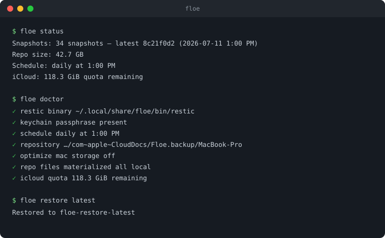

# floe

**Turn the iCloud storage you already pay for into a real versioned backup.**

[](https://github.com/Jszigeti/floe/actions/workflows/ci.yml)
[](https://github.com/Jszigeti/floe/releases)
[](LICENSE)




## Why

iCloud Drive is sync, not backup. Overwrite a file and the mistake propagates to every device in seconds. Delete one and it is gone everywhere. Time Machine solves this, but only if you remember to plug in a disk.

floe closes the gap: a daily snapshot of your home folder, encrypted, deduplicated and compressed, written into the iCloud storage you already pay for. Full history, one command to restore any version. Any synced folder works (Dropbox, Google Drive, an external disk). iCloud Drive is just the default.

| Alternative | The catch |
|---|---|
| iCloud Drive alone | syncs your files but keeps no history |
| Time Machine | needs a disk you actually plug in |
| Arq | does this well, for $50 |
| restic by hand | a great engine, but you own the config, the scheduling and the iCloud quirks |

floe is restic under the hood, with the macOS and iCloud parts handled for you.

## Install

```bash
curl -fsSL https://raw.githubusercontent.com/Jszigeti/floe/main/install.sh | sh
```

Piping curl into sh deserves a look first: [install.sh](install.sh) is 34 lines. You can also grab a binary from [GitHub Releases](https://github.com/Jszigeti/floe/releases) or build from source:

```bash
go install github.com/Jszigeti/floe/cmd/floe@latest
```

Works on Apple Silicon and Intel Macs. floe downloads its own restic binary (pinned version, sha256 verified), so there is nothing else to install.

## Quickstart

```bash
floe init
```

The wizard walks you through setup in about a minute: pick a destination (defaults to iCloud Drive), see a size estimate with your largest directories and exclude what you don't need, get a generated passphrase stored in the macOS Keychain (shown once, save it in your password manager), pick a backup hour. It then schedules the daily run and takes the first backup with live progress.

| Command | What it does |
|---|---|
| `floe init` | guided setup, then the first backup |
| `floe backup` | run a backup now |
| `floe status` | last snapshot, repo size, schedule, iCloud quota and sync state |
| `floe snapshots` | full backup history |
| `floe restore <id or latest> [path]` | restore a snapshot, or a single file from it |
| `floe doctor` | diagnose the iCloud pitfalls (see below) |
| `floe passphrase` | print the passphrase stored in the Keychain |
| `floe uninstall` | remove the daily schedule, keep all your data |

## What gets backed up

Your home folder, minus the noise. The defaults exclude what a fresh install can regenerate: caches, `node_modules` and friends, package-manager stores, SDKs, downloadable AI models, crash dumps, Docker's VM disk. Your documents, projects, photos, dotfiles and app settings (`~/Library/Preferences`, `~/Library/Application Support`) are all in. The wizard shows your largest directories at setup so you can trim further, and `paths` in the config accepts anything else you want covered. One default is a judgment call: excluding Ollama models assumes they can be pulled again, so remove that entry from the config if you build custom models locally.

Apps and the system are not copied, they are captured as a recipe instead: every backup writes a small manifest (Homebrew `Brewfile`, App Store apps, the contents of `/Applications`, your crontab) into `~/.local/state/floe/manifest`, inside the snapshot. On a new Mac you restore your files with floe, then replay the manifest to reinstall everything. Same outcome as copying 80 GB of apps, for a few kilobytes.

One macOS quirk to know: Mail, Messages and Safari data are protected by the system. Grant your terminal (and floe) Full Disk Access in System Settings → Privacy & Security if you want them included. Without it the backup still runs and you get at most one "backup incomplete" reminder a week instead of a daily failure. One catch worth knowing: macOS binds that permission to the exact binary, so every floe upgrade clears it and you have to grant it again. `floe doctor` tells you what the last scheduled run actually skipped, so you always know where you stand.

## How it works

- Each Mac gets its own restic repository at `<destination>/Floe.backup/<hostname>`. Repositories are never shared between machines because iCloud sync corrupts restic's locks when two Macs write to the same repo.
- A LaunchAgent runs the backup daily (1:00 PM by default). Each run applies retention first (keep 7 daily, 4 weekly, 6 monthly snapshots), then takes the new snapshot.
- The passphrase is generated at setup and lives in the macOS Keychain (service `floe`, account `restic`).
- Failures and low quota notify you immediately. Success is a weekly digest, never a daily ping.
- The engine is [restic](https://github.com/restic/restic): AES-256 encryption, content-defined deduplication and zstd compression. Unchanged files are never uploaded twice, and identical data across days is stored once.
- Trust is tested, not claimed: every commit runs an end-to-end suite that drives the real binary through init, backup, restore and doctor against a real restic, plus unit tests behind a 90% coverage floor and golangci-lint. The full wizard-to-restore cycle you saw in the demo above runs in CI.

## The iCloud problem

macOS "Optimize Mac Storage" can evict local file contents once they are synced, leaving dataless placeholders behind. If that happens inside the restic repository, backups and restores start failing in confusing ways. Quota runs out silently. Pruning during a half-finished sync can corrupt the repo.

This is floe's home turf:

- `floe doctor` detects evicted repo files and re-downloads them, warns when Optimize Mac Storage is on, and checks quota headroom.
- floe never prunes while an iCloud sync is pending. `floe status` shows `Retention: deferred` while that protection is active, and the prune runs at the start of the next backup instead.
- Quota is checked before every backup. If you are close to the limit you get a notification with options, and floe never deletes history to make room.

## Configuration

Everything lives in `~/.config/floe/config.toml`, written by the wizard and editable by hand:

```toml
destination = "/Users/you/Library/Mobile Documents/com~apple~CloudDocs"
hour = 13

[retention]
daily = 7
weekly = 4
monthly = 6

[scope]
paths = ["/Users/you"]
exclude = [
  "/Users/you/Library/Caches",
  "node_modules",
  "floe-restore-*",
]

[hooks]
# Shell commands that run before/after each backup.
# Example: export Docker volumes so they land in the snapshot.
# See docs/examples/export-docker-volumes.sh
pre = ["~/.config/floe/hooks/export-docker-volumes.sh"]
post = []
```

## FAQ

**Is my data encrypted?**
Yes. restic encrypts everything client-side with AES-256 before it touches the destination. Apple, Dropbox or Google only ever store ciphertext.

**What if I lose the passphrase?**
The backup is unrecoverable. There is no reset. Save it in a password manager the moment `floe init` shows it. `floe passphrase` prints it again as long as it is in your Keychain.

**Can I back up multiple Macs to the same iCloud account?**
Yes. Each Mac gets its own repository under `Floe.backup/<hostname>`, so they never collide.

**How do I restore on a new Mac?**
`floe init` on the new machine creates a fresh repository named after its hostname, so it won't see the old Mac's history by itself. To pull files from the old machine's backup: install floe, make sure the destination folder is synced locally, then run restic directly against the old repository:

```bash
RESTIC_REPOSITORY="<destination>/Floe.backup/<old-hostname>" \
RESTIC_PASSWORD="<saved passphrase>" \
~/.local/share/floe/bin/restic restore latest --target ./restored
```

## Uninstall

```bash
floe uninstall
```

This removes the daily schedule and nothing else: your snapshots, config and passphrase stay untouched. For a full removal, delete `~/.config/floe`, `~/.local/share/floe`, the `Floe.backup` folder in your destination, and the Keychain entry (`security delete-generic-password -s floe -a restic`). Your snapshots remain readable with plain restic and your passphrase.

## License

MIT, see [LICENSE](LICENSE).
